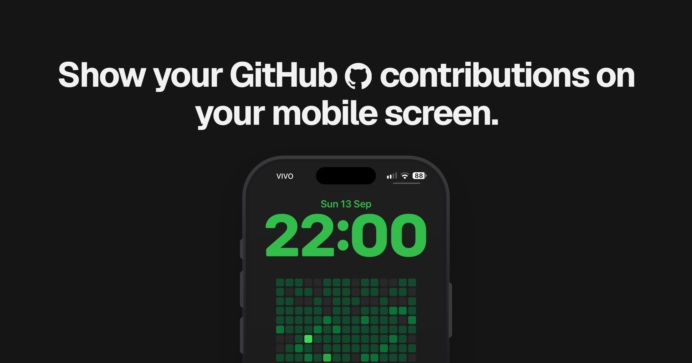

<div align="center">

<a href="https://thegitcalendar.vercel.app/"></a>

[](https://github.com/matheusaudibert/thegitcalendar/stargazers)
[](https://thegitcalendar.vercel.app/)
[](https://twitter.com/audibertdev)

</div>

# The Git Calendar

Backend API that turns a GitHub username into a **yearly commit wallpaper**, one commit dot per day of the year, colored by that day's GitHub contribution
intensity.

This repo is **backend only**: it renders the image. 

## Endpoints

### `GET /graph`

Renders the wallpaper image. `username` is the only required param, everything else, including it, is passed as a query param:

| Param | Default | Description |
|---|---|---|
| `username` | _(required)_ | GitHub username to render |
| `height` | `2556` | Output height in px. Any value from `64` to `4000`. |
| `width` | `1179` | Output width in px. Any value from `64` to `4000`. |
| `shape` | `rounded` | Shape of the commit: `rounded` (rounded-corner squares, like GitHub), `square` (sharp corners), or `circle`. |
| `background` | `github` | Named background preset: `github` (`#0d1117`), `dark` (`#1a1a1a`), or `light` (`#ffffff`). |
| `color` | _(none)_ | Named theme for commit levels 1-4: `green`, `blue`, `purple`, `red`, `yellow`, `orange`, `pink`, `white`, `black` |

Example:

```
GET https://gitcalendar-image.vercel.app/graph?username=matheusaudibert
```

Example with all params: 
```
GET https://gitcalendar-image.vercel.app/graph?username=matheusaudibert&background=github&color=green&shape=rounded&height=2556&width=1179
```
Image example:

<a href="https://thegitcalendar.vercel.app/"></a>

#### Resolutions

[RESOLUTIONS.md](RESOLUTIONS.md) lists every resolution already mapped for the API, iPhone and Android, with the exact `height` and `width` to use for each device. Any other size from `64` to `4000` px per side works too.

#### Support
If you're using this repo, feel free to show support and give this repo a ⭐ star! It means a lot, thank you :)
